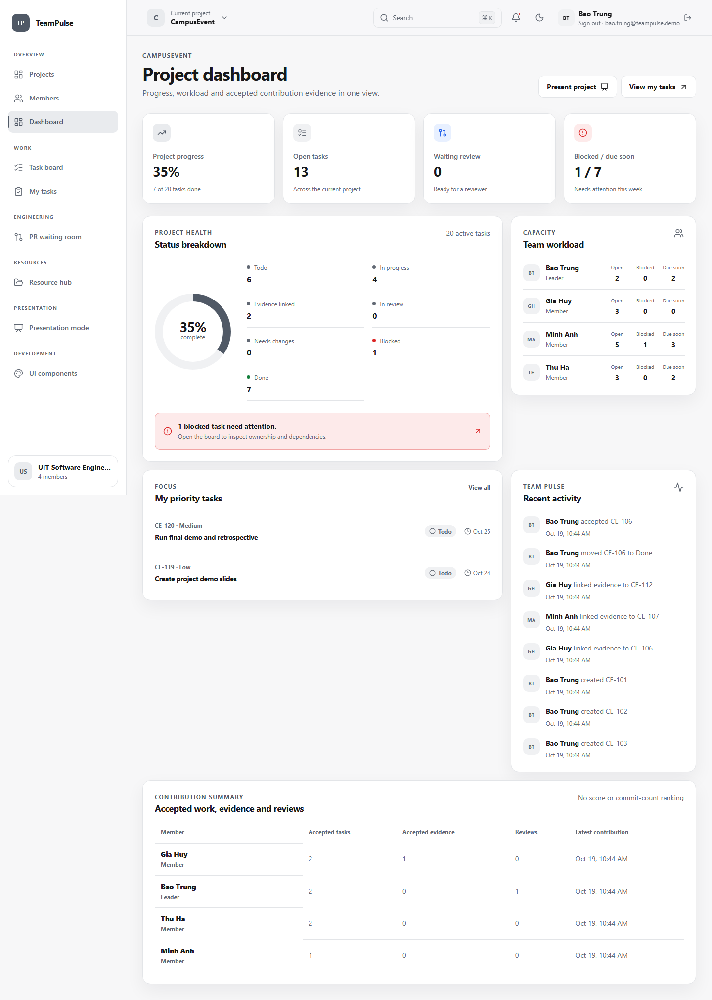
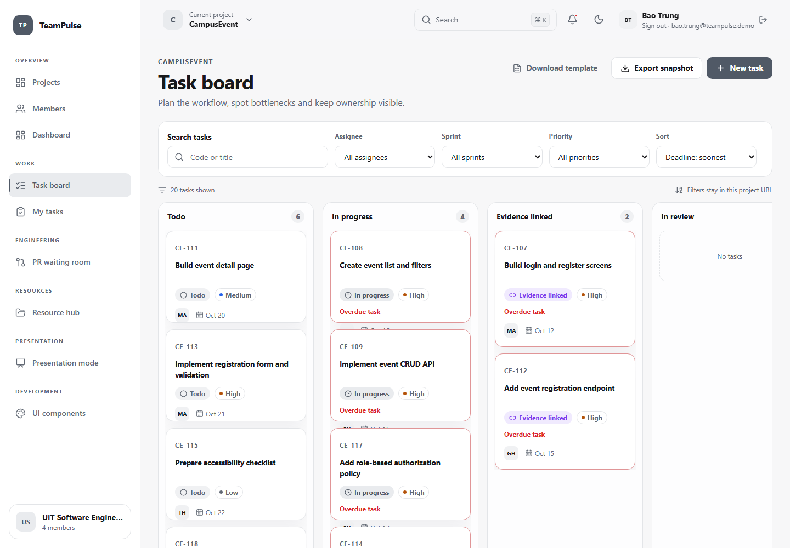
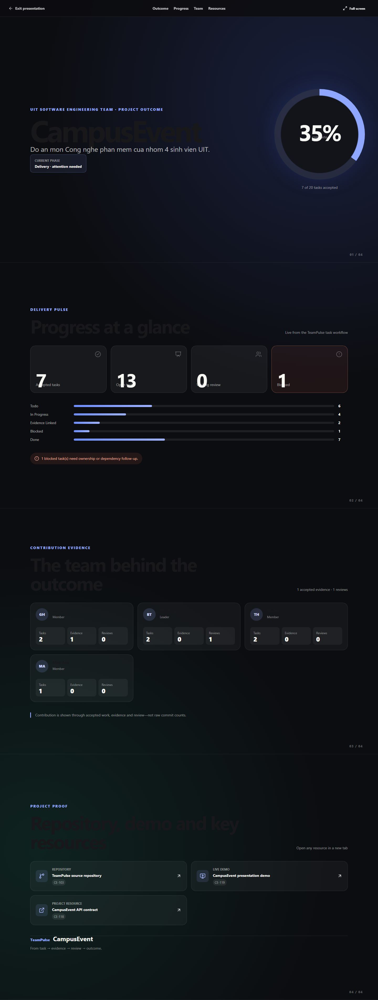
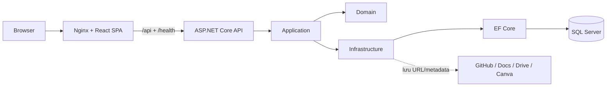
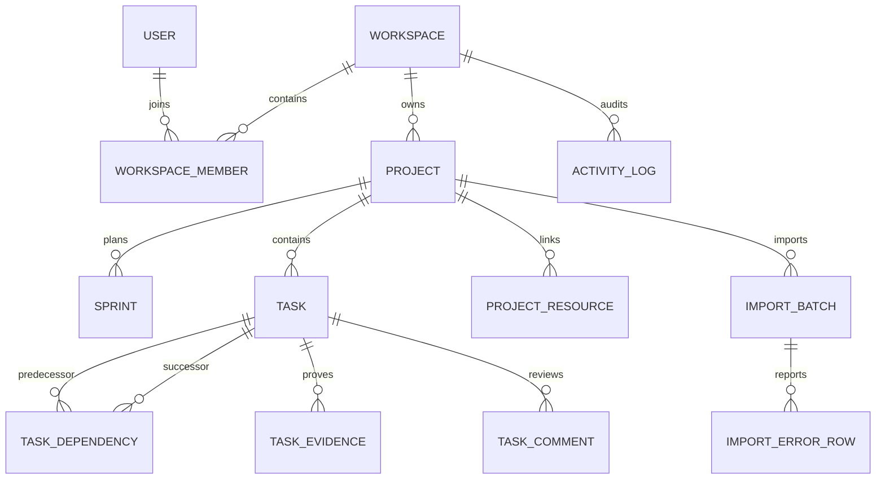

# TeamPulse

> **VI:** Trung tâm điều phối đồ án dành cho nhóm sinh viên: từ task, deadline và tài nguyên đến GitHub evidence, review, contribution report và presentation.
>
> **EN:** A project coordination hub for student teams—from tasks, deadlines, and resources to GitHub evidence, reviews, contribution reports, and presentations.


[](https://github.com/Btrung-uit/TeamPulse/actions/workflows/ci.yml)


**Live demo:** [teampulse-xgq8.onrender.com](https://teampulse-xgq8.onrender.com)

**Language / Ngôn ngữ:** [Tiếng Việt](#tiếng-việt) · [English](#english)

---

# Tiếng Việt

## Tổng quan

TeamPulse là một **Student Project & Engineering Collaboration Hub**. Sản phẩm tập trung giải quyết sự phân mảnh khi nhóm sinh viên phải chuyển đổi giữa bảng task, Google Docs, Google Drive, Canva, GitHub và ứng dụng nhắn tin để theo dõi một đồ án.

TeamPulse không thay thế các công cụ chuyên dụng đó. Nó trở thành nguồn sự thật cho tiến độ dự án và liên kết công việc theo chuỗi:

```text
Task → Evidence → Review → Contribution Report → Presentation
```

## Ảnh sản phẩm thật

Các ảnh dưới đây được chụp từ scenario tái tạo `UIT Software Engineering Team / CampusEvent`, không dùng mock UI.

| Dashboard | Task board |
| --- | --- |
| [](docs/screenshots/campusevent-dashboard.png) | [](docs/screenshots/campusevent-task-board.png) |

[](docs/screenshots/campusevent-presentation.png)

## Đối tượng sử dụng

- **Leader:** lập kế hoạch, phân công, theo dõi rủi ro và xác nhận đóng góp.
- **Member:** theo dõi công việc cá nhân, cập nhật tiến độ và gắn minh chứng.
- **Advisor:** theo dõi tiến độ và xem báo cáo mà không thay đổi dữ liệu vận hành.

## Tính năng chính

| Nhóm                 | Khả năng                                                                        |
| -------------------- | ------------------------------------------------------------------------------- |
| Workspace & Project  | Tạo nhóm, project, thành viên và quyền truy cập theo workspace                  |
| Work Management      | Sprint, task, deadline, priority, dependency, Kanban và activity log            |
| Dashboard            | Tiến độ, workload, task trễ hạn/blocked và hoạt động gần đây                    |
| Evidence             | Liên kết commit, pull request, issue, tài liệu, thiết kế và demo với task       |
| Excel Onboarding     | Upload → map cột → validate/preview → xác nhận import; export báo cáo `.xlsx`   |
| Resources            | Quản lý metadata/link của Google Docs, Drive, Canva, GitHub và bản demo         |
| Presentation Mode    | Tóm tắt tiến độ, thành viên, contribution, tài nguyên và demo cho giảng viên    |

GitHub webhook/PR automation, realtime notification và mobile workflow đầy đủ thuộc Phase 2–3. MVP có notification in-app cho assignment/review và vẫn chỉ lưu liên kết evidence/resource do người dùng cung cấp.

## Quy tắc workflow quan trọng

```text
Todo → In Progress → Evidence Linked → In Review → Done
```

- Commit chứa mã như `TP-123` chỉ gắn evidence; không tự hoàn thành task.
- PR mở hoặc ready for review đưa task sang `In Review`.
- Review yêu cầu sửa đưa task sang `Needs Changes`.
- Chỉ PR được merge vào nhánh đích hoặc leader xác nhận mới đưa task sang `Done`.
- Task đã có lịch sử/evidence được archive thay vì hard-delete.

## Nền tảng kỹ thuật hiện tại

| Phần           | Công nghệ                         |
| -------------- | --------------------------------- |
| Frontend       | React, TypeScript                 |
| Backend        | ASP.NET Core Web API              |
| Persistence    | SQL Server, Entity Framework Core |
| Authentication | ASP.NET Core Identity, JWT ngắn hạn + refresh cookie |
| Excel          | ClosedXML                         |
| Integration    | Resource mapping; repository webhook bảo mật; commit/PR automation |
| Delivery       | Docker Compose, GitHub Actions    |
| Architecture   | Modular monolith trong monorepo   |

## Kiến trúc cấp cao



Backend là modular monolith: `Api` phụ trách HTTP/auth, `Application` chứa contract/use case, `Domain` giữ entity và invariant, `Infrastructure` hiện thực persistence và service. `WorkspaceId` là tenant boundary; authorization được kiểm tra ở endpoint/policy và query filter.

## ERD rút gọn



ERD chi tiết và invariant: [`m1-foundation-erd.md`](docs/diagrams/m1-foundation-erd.md), [`m2-task-domain-erd.md`](docs/diagrams/m2-task-domain-erd.md).

## API overview

Mọi route nghiệp vụ đều yêu cầu Bearer access token; refresh token nằm trong cookie `HttpOnly`. Các route lồng `workspaceId`/`projectId` được kiểm tra membership và role.

| Nhóm | Route chính | Quyền ghi |
| --- | --- | --- |
| Auth | `/api/auth/register`, `/login`, `/refresh`, `/logout`, `/me` | Người dùng |
| Workspace | `/api/workspaces`, `/{id}/members` | Leader quản lý member/role |
| Project | `/api/workspaces/{wid}/projects` | Leader |
| Planning | `/{pid}/sprints`, `/dependencies` | Leader |
| Task | `/{pid}/tasks`, `/{taskId}/status` | Leader/member theo workflow |
| Excel | `/{pid}/tasks/imports`, `/template`, `/export` | Leader import; member đọc/export |
| Collaboration | `/{taskId}/evidence`, `/review` | Assignee/Leader; Leader review |
| Dashboard/resource | `/{pid}/dashboard`, `/{pid}/resources` | Member đọc; Leader quản lý resource |

Chi tiết task/import/export: [`docs/api/tasks.md`](docs/api/tasks.md); planning/dependency: [`docs/api/planning.md`](docs/api/planning.md).

## Cấu trúc repository

```text
TeamPulse/
├── .github/workflows/              # CI/CD
├── src/
│   ├── backend/
│   │   ├── TeamPulse.Api/
│   │   ├── TeamPulse.Application/
│   │   ├── TeamPulse.Domain/
│   │   └── TeamPulse.Infrastructure/
│   └── frontend/
│       ├── public/
│       └── src/
│           ├── app/
│           ├── components/ui/
│           ├── features/
│           ├── hooks/
│           ├── lib/
│           ├── pages/
│           ├── styles/
│           └── types/
├── tests/
│   ├── backend/
│   │   ├── TeamPulse.UnitTests/
│   │   └── TeamPulse.IntegrationTests/
│   ├── frontend/
│   └── e2e/
├── database/
│   ├── init/
│   └── seed/
├── docs/
│   ├── adr/
│   ├── api/
│   ├── design/
│   ├── diagrams/
│   └── TeamPulse-Brain/
├── scripts/
├── .env.example
├── docker-compose.yml
├── TeamPulse.sln
├── global.json
├── CONTEXT.md
└── README.md
```

## Phân kỳ

### MVP

Auth, workspace, project, role, task/sprint, dashboard, activity log, evidence link, Excel import/export, Resource Hub, Presentation Mode và Git Command Generator.

### Phase 2

GitHub App/Webhook, PR Waiting Room, tự động hóa trạng thái, SignalR và notification nâng cao.

### Phase 3

Google Drive API, dependency visualization, advisor dashboard và analytics nâng cao.

## Thiết kế giao diện

- **Dark:** Obsidian Black + Muted Gold.
- **Light:** Porcelain White + Cool Silver.
- Data-first, bo tròn có kiểm soát, chuyển động ngắn và có mục đích.
- Desktop-first; mobile tập trung theo dõi và thao tác nhanh có rủi ro thấp.
- Trạng thái nghiệp vụ luôn có text/icon, không chỉ biểu diễn bằng màu.

## Chạy local

Yêu cầu: Docker Desktop (hoặc Docker Engine với Compose v2), .NET SDK 10.0.401 trở lên và Node.js `^20.19.0` hoặc `>=22.12.0`.

Thiết lập SQL Server lần đầu:

```powershell
Copy-Item .env.example .env
# Đổi cả hai placeholder MSSQL_SA_PASSWORD và JWT_SIGNING_KEY.
docker compose up -d

# Dùng cùng password vừa đặt trong .env; secret được lưu ngoài repository.
dotnet user-secrets set --project src/backend/TeamPulse.Api `
  "ConnectionStrings:TeamPulse" `
  "Server=localhost,1433;Database=TeamPulse;User Id=sa;Password=<your-password>;TrustServerCertificate=True"

# Tạo JWT signing key ngẫu nhiên; chỉ lưu bằng User Secrets.
$jwtSigningKey = [Convert]::ToBase64String(
  [Security.Cryptography.RandomNumberGenerator]::GetBytes(48))
dotnet user-secrets set --project src/backend/TeamPulse.Api `
  "Authentication:Jwt:SigningKey" $jwtSigningKey

# Cài local tool và áp dụng EF Core migrations vào database trống/hiện có.
dotnet tool restore
dotnet tool run dotnet-ef database update `
  --project src/backend/TeamPulse.Infrastructure `
  --startup-project src/backend/TeamPulse.Api
```

Những lần sau, `docker compose up -d` chỉ khởi động SQL Server cho workflow phát triển; lệnh EF ở trên tạo/cập nhật database.

```powershell
# Backend: restore, build và test
dotnet restore TeamPulse.sln
dotnet build TeamPulse.sln --no-restore
dotnet test TeamPulse.sln --no-build

# Chạy API tại http://localhost:5249
dotnet run --project src/backend/TeamPulse.Api
```

Trong terminal khác:

```powershell
cd src/frontend
npm ci
npm run dev
```

Các health endpoint:

- `GET http://localhost:5249/health` hoặc `/health/live`: API đang chạy.
- `GET http://localhost:5249/health/ready`: API kết nối được SQL Server.

Kiểm tra production build của frontend bằng `npm run build`. Dừng hạ tầng local bằng `docker compose down`; named volume giữ lại dữ liệu giữa các lần chạy.

### Cấu hình GitHub repository webhook

TP-060 cung cấp endpoint `POST /api/integrations/github/webhook`, xác thực `X-Hub-Signature-256`, chống replay bằng `X-GitHub-Delivery`, lưu audit bền vững và xử lý delivery bất đồng bộ. TP-061 tự gắn commit/PR evidence, chuyển trạng thái theo vòng đời PR và giữ manual override của leader với audit actor rõ ràng. Webhook mặc định tắt; secret chỉ được cấu hình server-side.

Hướng dẫn tạo secret, bật integration và cấu hình event trong GitHub: [`docs/integrations/github-repository-webhook.md`](docs/integrations/github-repository-webhook.md).

Để route webhook vào đúng project, tạo Resource loại `GitHub` với External ID theo dạng `owner/repository`. Commit message hoặc PR title/body phải chứa task code như `TP-123`.

### E2E core demo flow

Playwright tự khởi động frontend và một API riêng dùng database InMemory sạch, sau đó chạy luồng `Leader import → Member evidence → Leader review → Dashboard/Presentation`. Không cần Docker hay SQL Server cho smoke test này:

```powershell
cd src/frontend
npm ci
npx playwright install chromium # chỉ cần ở lần đầu
npm run e2e
```

Khi thất bại, screenshot, video và trace nằm trong `src/frontend/test-results`; báo cáo HTML nằm trong `src/frontend/playwright-report`. API E2E chỉ dùng cấu hình InMemory do Playwright truyền vào và không thay đổi provider SQL Server mặc định của ứng dụng.

### Chạy production-like bằng Docker

Stack đầy đủ gồm SQL Server, EF migration bundle một lần, API và frontend Nginx reverse proxy:

```powershell
.\scripts\New-DeploymentEnv.ps1
docker compose --profile app up --build -d
docker compose --profile app ps -a
```

Mở `http://localhost:8080`; readiness công khai tại `http://localhost:8080/health/ready`. Hướng dẫn cấu hình production, deploy từ `main`, kiểm tra mobile, backup và rollback nằm trong [`docs/deployment/production-like.md`](docs/deployment/production-like.md).

### Bản triển khai công khai

MVP hiện chạy tại [https://teampulse-xgq8.onrender.com](https://teampulse-xgq8.onrender.com) với React SPA và ASP.NET Core API trong một Render Web Service tại Singapore; dữ liệu được lưu trong Azure SQL Database.

- Liveness: [`/health/live`](https://teampulse-xgq8.onrender.com/health/live)
- Readiness (bao gồm kết nối database): [`/health/ready`](https://teampulse-xgq8.onrender.com/health/ready)
- Cấu hình triển khai: [`render.yaml`](render.yaml) và root [`Dockerfile`](Dockerfile)
- Runbook Render/Azure SQL: [`docs/deployment/render-azure-sql.md`](docs/deployment/render-azure-sql.md)

Render Free có thể spin down khi không có traffic, nên request đầu tiên sau thời gian không hoạt động có thể chậm hơn. Không commit connection string hoặc JWT signing key; chúng được cấu hình bằng secret environment variables trên Render.

Tạo scenario portfolio hoàn chỉnh sau khi stack healthy:

```powershell
.\scripts\Seed-DemoScenario.ps1
```

Script gọi API như người dùng thật và có thể chạy lại an toàn. Nó tạo 4 tài khoản UIT demo, 1 workspace, project `CampusEvent`, 20 task có deadline/dependency, 3 evidence, 1 review được chấp nhận và 3 resource link. Không cần nhập tay hoặc chạy SQL. Tài khoản leader local: `bao.trung@teampulse.demo`; mật khẩu mặc định chỉ dành cho local là `TeamPulseDemo2026!` và có thể đổi bằng `-DemoPassword`.

Nếu đổi `APP_PORT`, truyền API tương ứng, ví dụ:

```powershell
.\scripts\Seed-DemoScenario.ps1 -ApiBaseUrl http://localhost:8088/api
```

Chụp lại ảnh README từ chính dữ liệu vừa seed:

```powershell
cd src/frontend
$env:TEAMPULSE_WEB_URL = "http://localhost:8080"
npm run screenshots
```

## Continuous Integration

Workflow `CI` chạy trên mọi pull request vào `main`, mọi push lên `main` và khi kích hoạt thủ công. Bốn check ổn định là:

- `Backend`: restore, kiểm tra format, build Release và chạy test .NET.
- `Frontend`: `npm ci`, lint, kiểm tra format, component tests và production build.
- `E2E Smoke`: khởi động clean InMemory API, chạy core demo flow bằng Chromium và tải failure evidence lên artifact.
- `Docker production build`: xác thực Compose và build frontend, API, migration images.
- `CI Gate`: chỉ thành công khi bốn job trên đều thành công.

Workflow chỉ có quyền đọc source code và không sử dụng application secret. Khi repository có collaborator, hãy đặt `CI Gate` làm required status check của `main`.

## Trạng thái dự án

MVP portfolio đã có auth, multi-workspace switch/create, workspace-scoped search, in-app assignment/review notification, project/task/planning, transactional Excel onboarding, evidence/review, dashboard, Resource Hub, Presentation Mode, accessibility states, security hardening, E2E core flow, Docker production-like và bản public deployment trên Render + Azure SQL. Repository webhook đã có signature verification, deduplication, delivery audit, background processing, commit/PR automation và PR Waiting Room với notification deep-link sang GitHub; realtime SignalR vẫn thuộc Phase 2–3.

## Project Brain

Các quyết định, quy tắc domain, thiết kế, kiến trúc, tích hợp và kế hoạch delivery được chia thành atomic notes tại [`docs/TeamPulse-Brain`](docs/TeamPulse-Brain/00-Home/Home.md).

`CONTEXT.md` là glossary chuẩn cho code. `docs/adr/` là nơi lưu các quyết định kiến trúc khó đảo ngược.

---

# English

## Overview

TeamPulse is a **Student Project & Engineering Collaboration Hub** designed to reduce the fragmentation created by switching between task spreadsheets, Google Docs, Google Drive, Canva, GitHub, and messaging apps.

It does not replace those specialist tools. TeamPulse is the source of truth for project progress and connects work through:

```text
Task → Evidence → Review → Contribution Report → Presentation
```

## Intended users

- **Leader:** plans work, assigns ownership, monitors risks, and confirms contributions.
- **Member:** tracks personal tasks, reports progress, and attaches evidence.
- **Advisor:** observes progress and reports without changing operational data.

## Planned capabilities

- Workspace, projects, membership, and workspace-scoped authorization.
- Sprint, task, deadline, dependency, Kanban, and immutable activity history.
- Progress, workload, overdue, blocked, and contribution dashboards.
- Task evidence linked to commits, pull requests, issues, documents, designs, and demos.
- Transactional Excel import with mapping and preview, plus `.xlsx` export.
- Resource links for Google Docs, Drive, Canva, GitHub, and deployed demos.
- Presentation Mode for project demonstrations and assessment.
- Secure repository webhook intake, evidence-driven task transitions, and a PR Waiting Room with GitHub deep links.
- Monitoring-first mobile experience for Home, My Tasks, Inbox, PRs, and Resources.

## Planned stack

React + TypeScript, ASP.NET Core Web API, SQL Server, Entity Framework Core, ASP.NET Core Identity, JWT, SignalR, ClosedXML, Docker Compose, and GitHub Actions in a modular monolith monorepo.

## Delivery phases

- **MVP:** core identity, work management, dashboards, activity/evidence, Excel onboarding, resource links, presentation, and Git command guidance.
- **Phase 2:** repository webhook foundation, commit/PR workflow automation, PR Waiting Room, realtime updates, and richer notifications.
- **Phase 3:** Drive integration, dependency visualization, advisor views, and advanced analytics.

## Run locally

Requirements: Docker Desktop (or Docker Engine with Compose v2), .NET SDK 10.0.401 or newer, and Node.js `^20.19.0` or `>=22.12.0`.

Set up SQL Server for the first time:

```powershell
Copy-Item .env.example .env
# Replace both MSSQL_SA_PASSWORD and JWT_SIGNING_KEY placeholders.
docker compose up -d

# Use the same password configured in .env; the secret is stored outside the repository.
dotnet user-secrets set --project src/backend/TeamPulse.Api `
  "ConnectionStrings:TeamPulse" `
  "Server=localhost,1433;Database=TeamPulse;User Id=sa;Password=<your-password>;TrustServerCertificate=True"

# Generate a random JWT signing key and keep it in User Secrets only.
$jwtSigningKey = [Convert]::ToBase64String(
  [Security.Cryptography.RandomNumberGenerator]::GetBytes(48))
dotnet user-secrets set --project src/backend/TeamPulse.Api `
  "Authentication:Jwt:SigningKey" $jwtSigningKey

# Restore the local tool and apply EF Core migrations to an empty or existing database.
dotnet tool restore
dotnet tool run dotnet-ef database update `
  --project src/backend/TeamPulse.Infrastructure `
  --startup-project src/backend/TeamPulse.Api
```

On subsequent runs, `docker compose up -d` starts SQL Server for the development workflow; the EF command above creates or updates the database.

```powershell
# Backend: restore, build, and test
dotnet restore TeamPulse.sln
dotnet build TeamPulse.sln --no-restore
dotnet test TeamPulse.sln --no-build

# Run the API at http://localhost:5249
dotnet run --project src/backend/TeamPulse.Api
```

In another terminal:

```powershell
cd src/frontend
npm ci
npm run dev
```

Health endpoints:

- `GET http://localhost:5249/health` or `/health/live`: the API process is running.
- `GET http://localhost:5249/health/ready`: the API can connect to SQL Server.

Verify the frontend production build with `npm run build`. Stop local infrastructure with `docker compose down`; the named volume preserves data between runs.

### GitHub repository webhook

TP-060 exposes `POST /api/integrations/github/webhook` with HMAC-SHA256 signature verification, delivery deduplication, durable audit records, and asynchronous processing. TP-061 adds idempotent commit/PR evidence, PR-driven task transitions, system-attributed activities, and auditable leader overrides. It is disabled by default and its secret remains server-side. See [`docs/integrations/github-repository-webhook.md`](docs/integrations/github-repository-webhook.md) for repository mapping, setup, events, and lifecycle rules.

### Production-like Docker stack

Run SQL Server, a one-shot EF migration bundle, the API, and the Nginx-hosted frontend with:

```powershell
.\scripts\New-DeploymentEnv.ps1
docker compose --profile app up --build -d
docker compose --profile app ps -a
```

Open `http://localhost:8080`; public readiness is available at `http://localhost:8080/health/ready`. See [`docs/deployment/production-like.md`](docs/deployment/production-like.md) for production configuration, deployment from `main`, mobile verification, backup, and rollback.

### Public deployment

The MVP is live at [https://teampulse-xgq8.onrender.com](https://teampulse-xgq8.onrender.com). The React SPA and ASP.NET Core API run in one Render Web Service in Singapore, backed by Azure SQL Database.

- Liveness: [`/health/live`](https://teampulse-xgq8.onrender.com/health/live)
- Readiness (including database connectivity): [`/health/ready`](https://teampulse-xgq8.onrender.com/health/ready)
- Deployment configuration: [`render.yaml`](render.yaml) and the root [`Dockerfile`](Dockerfile)
- Render/Azure SQL runbook: [`docs/deployment/render-azure-sql.md`](docs/deployment/render-azure-sql.md)

Render Free services can spin down when idle, so the first request after an inactive period can be slower. The database connection string and JWT signing key are injected through Render secret environment variables and must never be committed.

## Continuous Integration

The `CI` workflow runs for every pull request targeting `main`, every push to `main`, and manual dispatches. Its four required checks are:

- `Backend`: restore, formatting verification, Release build, and .NET tests.
- `Frontend`: `npm ci`, lint, formatting verification, component tests, and production build.
- `E2E Smoke`: starts a clean InMemory API and runs the Chromium core demo flow.
- `Docker production build`: validates Compose and builds the frontend, API, and migration images.
- `CI Gate`: succeeds only when all four jobs above succeed.

The workflow has read-only source access and does not consume application secrets. Once the repository has collaborators, configure `CI Gate` as a required status check for `main`.

## Current status

The portfolio MVP includes authentication, multi-workspace switching and creation, workspace-scoped search, in-app assignment/review notifications, project/task planning, transactional Excel onboarding, evidence and review workflows, dashboards, Resource Hub, Presentation Mode, accessibility states, security hardening, an E2E core flow, a production-like Docker stack, and a public Render + Azure SQL deployment. The repository webhook verifies signatures, deduplicates deliveries, stores an audit trail, processes deliveries asynchronously, automates commit/PR evidence and task status, and projects a polling-based PR Waiting Room with GitHub deep-link notifications; realtime SignalR remains later work.

## Documentation

Open the project knowledge base at [`docs/TeamPulse-Brain`](docs/TeamPulse-Brain/00-Home/Home.md). Canonical domain language lives in [`CONTEXT.md`](CONTEXT.md), while durable architectural decisions live in [`docs/adr`](docs/adr/).

## License

No license has been selected yet. All rights remain reserved until a license file is added.
