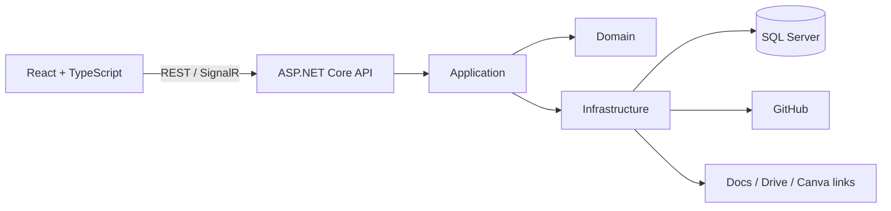

# TeamPulse

> **VI:** Trung tâm điều phối đồ án dành cho nhóm sinh viên: từ task, deadline và tài nguyên đến GitHub evidence, review, contribution report và presentation.
>
> **EN:** A project coordination hub for student teams—from tasks, deadlines, and resources to GitHub evidence, reviews, contribution reports, and presentations.


**Language / Ngôn ngữ:** [Tiếng Việt](#tiếng-việt) · [English](#english)

---

# Tiếng Việt

## Tổng quan

TeamPulse là một **Student Project & Engineering Collaboration Hub**. Sản phẩm tập trung giải quyết sự phân mảnh khi nhóm sinh viên phải chuyển đổi giữa bảng task, Google Docs, Google Drive, Canva, GitHub và ứng dụng nhắn tin để theo dõi một đồ án.

TeamPulse không thay thế các công cụ chuyên dụng đó. Nó trở thành nguồn sự thật cho tiến độ dự án và liên kết công việc theo chuỗi:

```text
Task → Evidence → Review → Contribution Report → Presentation
```

## Đối tượng sử dụng

- **Leader:** lập kế hoạch, phân công, theo dõi rủi ro và xác nhận đóng góp.
- **Member:** theo dõi công việc cá nhân, cập nhật tiến độ và gắn minh chứng.
- **Advisor/Viewer:** theo dõi tiến độ và xem báo cáo mà không thay đổi dữ liệu vận hành.

## Tính năng chính

| Nhóm | Khả năng |
|---|---|
| Workspace & Project | Tạo nhóm, project, thành viên và quyền truy cập theo workspace |
| Work Management | Sprint, task, deadline, priority, dependency, Kanban và activity log |
| Dashboard | Tiến độ, workload, task trễ hạn/blocked và hoạt động gần đây |
| Evidence | Liên kết commit, pull request, issue, tài liệu, thiết kế và demo với task |
| Excel Onboarding | Upload → map cột → validate/preview → xác nhận import; export báo cáo `.xlsx` |
| Resources | Quản lý metadata/link của Google Docs, Drive, Canva, GitHub và bản demo |
| Presentation Mode | Tóm tắt tiến độ, thành viên, contribution, tài nguyên và demo cho giảng viên |
| GitHub Collaboration | PR Waiting Room, webhook, tự gắn evidence và chuyển trạng thái theo PR workflow |
| Notifications | Task mới, deadline, comment, review request và trạng thái PR |
| Mobile Monitoring | Theo dõi tiến độ, My Tasks, Inbox, PR và Resources với thao tác rủi ro thấp |

## Quy tắc workflow quan trọng

```text
Todo → In Progress → Evidence Linked → In Review → Done
```

- Commit chứa mã như `TP-123` chỉ gắn evidence; không tự hoàn thành task.
- PR mở hoặc ready for review đưa task sang `In Review`.
- Review yêu cầu sửa đưa task sang `Needs Changes`.
- Chỉ PR được merge vào nhánh đích hoặc leader xác nhận mới đưa task sang `Done`.
- Task đã có lịch sử/evidence được archive thay vì hard-delete.

## Nền tảng kỹ thuật dự kiến

| Phần | Công nghệ |
|---|---|
| Frontend | React, TypeScript |
| Backend | ASP.NET Core Web API |
| Persistence | SQL Server, Entity Framework Core |
| Authentication | ASP.NET Core Identity, JWT |
| Realtime | SignalR |
| Excel | ClosedXML |
| Integration | GitHub App, REST API, Webhooks |
| Delivery | Docker Compose, GitHub Actions |
| Architecture | Modular monolith trong monorepo |

## Kiến trúc cấp cao



## Cấu trúc repository

```text
TeamPulse/
├── .github/workflows/              # CI/CD
├── src/
│   ├── backend/
│   │   ├── TeamPulse.Api/
│   │   ├── TeamPulse.Application/
│   │   ├── TeamPulse.Domain/
│   │   └── TeamPulse.Infrastructure/
│   └── frontend/
│       ├── public/
│       └── src/
│           ├── app/
│           ├── components/ui/
│           ├── features/
│           ├── hooks/
│           ├── lib/
│           ├── pages/
│           ├── styles/
│           └── types/
├── tests/
│   ├── backend/
│   │   ├── TeamPulse.UnitTests/
│   │   └── TeamPulse.IntegrationTests/
│   ├── frontend/
│   └── e2e/
├── database/seed/
├── docs/
│   ├── adr/
│   ├── api/
│   ├── design/
│   ├── diagrams/
│   └── TeamPulse-Brain/TeamPulse-Vault/
├── scripts/
├── CONTEXT.md
└── README.md
```

## Phân kỳ

### MVP

Auth, workspace, project, role, task/sprint, dashboard, activity log, evidence link, Excel import/export, Resource Hub, Presentation Mode và Git Command Generator.

### Phase 2

GitHub App/Webhook, PR Waiting Room, tự động hóa trạng thái, SignalR và notification nâng cao.

### Phase 3

Google Drive API, dependency visualization, advisor dashboard và analytics nâng cao.

## Thiết kế giao diện

- **Dark:** Obsidian Black + Muted Gold.
- **Light:** Porcelain White + Cool Silver.
- Data-first, bo tròn có kiểm soát, chuyển động ngắn và có mục đích.
- Desktop-first; mobile tập trung theo dõi và thao tác nhanh có rủi ro thấp.
- Trạng thái nghiệp vụ luôn có text/icon, không chỉ biểu diễn bằng màu.

## Trạng thái dự án

Hiện tại dự án đang ở giai đoạn **planning và design**. Cấu trúc source đã được chuẩn bị nhưng chưa scaffold ứng dụng chạy được. Hướng dẫn build/run sẽ được bổ sung sau khi khởi tạo backend, frontend và Docker Compose.

## Project Brain

Các quyết định, quy tắc domain, thiết kế, kiến trúc, tích hợp và kế hoạch delivery được chia thành atomic notes tại [`docs/TeamPulse-Brain/TeamPulse-Vault`](docs/TeamPulse-Brain/TeamPulse-Vault/00-Home/Home.md).

`CONTEXT.md` là glossary chuẩn cho code. `docs/adr/` là nơi lưu các quyết định kiến trúc khó đảo ngược.

---

# English

## Overview

TeamPulse is a **Student Project & Engineering Collaboration Hub** designed to reduce the fragmentation created by switching between task spreadsheets, Google Docs, Google Drive, Canva, GitHub, and messaging apps.

It does not replace those specialist tools. TeamPulse is the source of truth for project progress and connects work through:

```text
Task → Evidence → Review → Contribution Report → Presentation
```

## Intended users

- **Leader:** plans work, assigns ownership, monitors risks, and confirms contributions.
- **Member:** tracks personal tasks, reports progress, and attaches evidence.
- **Advisor/Viewer:** observes progress and reports without changing operational data.

## Planned capabilities

- Workspace, projects, membership, and workspace-scoped authorization.
- Sprint, task, deadline, dependency, Kanban, and immutable activity history.
- Progress, workload, overdue, blocked, and contribution dashboards.
- Task evidence linked to commits, pull requests, issues, documents, designs, and demos.
- Transactional Excel import with mapping and preview, plus `.xlsx` export.
- Resource links for Google Docs, Drive, Canva, GitHub, and deployed demos.
- Presentation Mode for project demonstrations and assessment.
- GitHub PR Waiting Room, webhook automation, and evidence-driven task transitions.
- Monitoring-first mobile experience for Home, My Tasks, Inbox, PRs, and Resources.

## Planned stack

React + TypeScript, ASP.NET Core Web API, SQL Server, Entity Framework Core, ASP.NET Core Identity, JWT, SignalR, ClosedXML, Docker Compose, and GitHub Actions in a modular monolith monorepo.

## Delivery phases

- **MVP:** core identity, work management, dashboards, activity/evidence, Excel onboarding, resource links, presentation, and Git command guidance.
- **Phase 2:** GitHub App/webhooks, PR Waiting Room, workflow automation, realtime updates, and richer notifications.
- **Phase 3:** Drive integration, dependency visualization, advisor views, and advanced analytics.

## Current status

The project is in **planning and design**. The source tree exists, but no runnable backend/frontend application has been scaffolded yet. Build and run instructions will be added once the implementation foundation is created.

## Documentation

Open the project knowledge base at [`docs/TeamPulse-Brain/TeamPulse-Vault`](docs/TeamPulse-Brain/TeamPulse-Vault/00-Home/Home.md). Canonical domain language lives in [`CONTEXT.md`](CONTEXT.md), while durable architectural decisions live in [`docs/adr`](docs/adr/).

## License

No license has been selected yet. All rights remain reserved until a license file is added.
