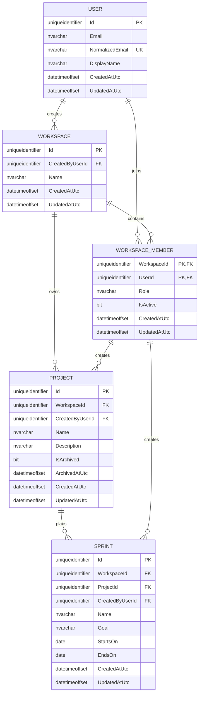

# Milestone 1 foundation ERD

This diagram documents the relational foundation introduced by `TP-010`.
`Workspace` is the tenant boundary; composite foreign keys carry that boundary
into project and sprint ownership.

## Enforced invariants

- `WorkspaceMember` is unique by `(WorkspaceId, UserId)`.
- A `Project` creator must be a member of the same workspace through the
  `(WorkspaceId, CreatedByUserId)` foreign key.
- A `Sprint` must belong to a project in the same workspace through the
  `(WorkspaceId, ProjectId)` foreign key.
- A sprint cannot end before it starts.
- Project archive flag and archive timestamp must change together.
- Workspace-owned entities are protected by EF Core query filters. Code that
  intentionally crosses workspaces must explicitly opt out and perform its own
  authorization check.
