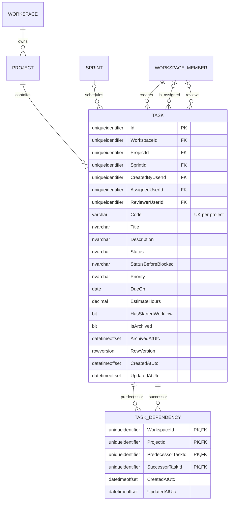

# Milestone 2 task domain ERD

This diagram documents the task aggregate introduced by `TP-020`. `WorkspaceId`
and `ProjectId` are carried through composite keys so relational integrity, not
only application code, prevents tenant and project boundary violations.

## Enforced invariants

- `(WorkspaceId, ProjectId, Code)` is unique.
- Creator, assignee, and reviewer reference membership in the same workspace.
- Sprint assignment references a sprint in the same workspace and project.
- Both dependency endpoints reference tasks in the same workspace and project.
- A dependency cannot point a task to itself; application-level graph traversal rejects direct and indirect cycles before insert.
- Status, priority, estimate, blocked-state, and archive-state check constraints
  protect persisted data in addition to domain validation.
- `RowVersion` is the optimistic concurrency token.
- Task and dependency queries are denied until the request selects a workspace.
